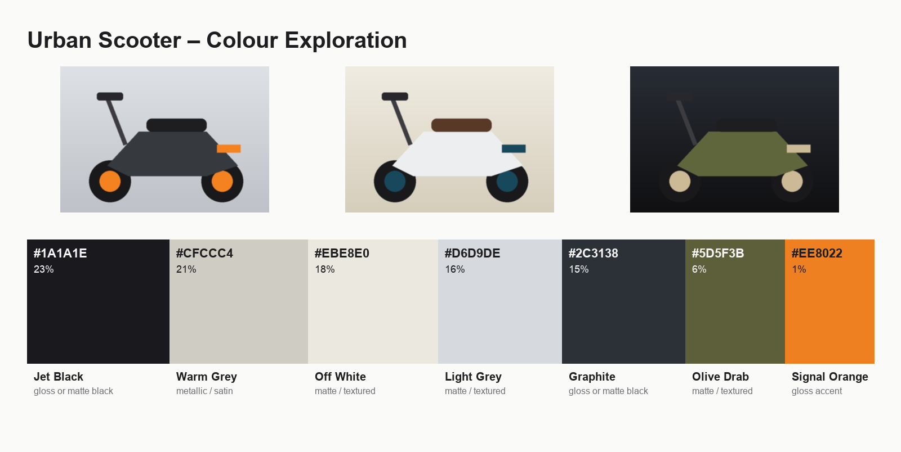

# CMF Palette Studio

**▶ [Try it live in your browser](https://subzero-005.github.io/cmf/)** (no install needed, and images never leave your device)

**Turn a pile of reference photos into a colour board in seconds.**



## The problem

When a CMF (Colour, Material, Finish) designer starts a new colourway, they collect dozens of reference images: competitor products, mood shots, material samples. Pulling the colours out of them usually means eyedropping each one by hand in Photoshop or Illustrator, copying hex codes into a document and then building a board for the review. It's slow, repetitive work that adds nothing creative.

## What it does

- Upload any number of reference images (JPG, PNG with transparency, WEBP).
- It finds the dominant colours in each image using k-means clustering, then merges them into one board palette weighted by how much of each image every colour covers.
- Every swatch gets a hex code, its share of the palette, a CMF-style name (Graphite, Petrol Blue, Signal Orange…) and a rough finish hint (metallic/satin, gloss accent, matte).
- Small accent colours stay visible on the board even when they only cover 1% of the images, because accents are often the most important part of a colourway.
- Export the board as **PNG** (for Slack and decks), **PDF** (for print) and **JSON** (to reuse the palette in other tools).
- Transparent pixels are ignored, so cut-out product shots don't add fake black or white.

## Run it

```bash
python -m venv .venv && source .venv/bin/activate
pip install -r requirements.txt
python app.py
```

Open http://127.0.0.1:7860, drop in some images and click **Build board**. Sample images are in [`examples/`](examples/).

## Use it from Python

```python
from PIL import Image
from cmf import extract_palette, merge_palettes, render_board

images = [Image.open(p) for p in ["ref1.jpg", "ref2.jpg"]]
palette = merge_palettes([extract_palette(i, colours=5) for i in images], colours=6)
for s in palette:
    print(s.hex, s.name, f"{s.share:.0%}", s.finish_hint)
render_board(images, palette, "Spring colourway").save("board.png")
```

## Tests

```bash
pip install pytest
python -m pytest
```

## Next steps

- Match swatches to the team's own paint and material library instead of generic names
- Pantone / RAL lookup
- Upload a material photo and get texture tags (grain, weave, brushed) from a vision model

**Stack:** Python · scikit-learn (k-means) · Pillow · Gradio
